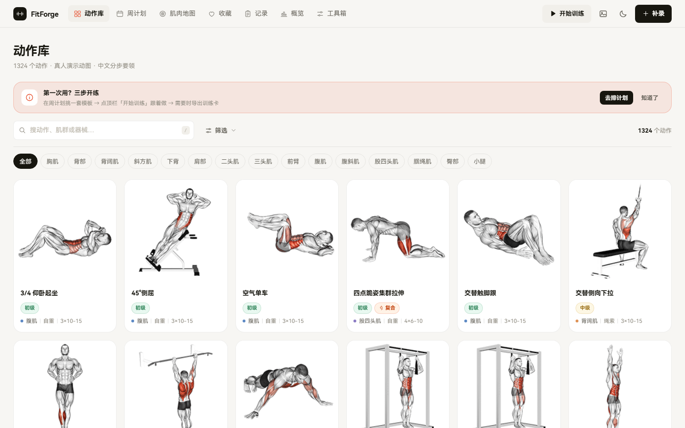
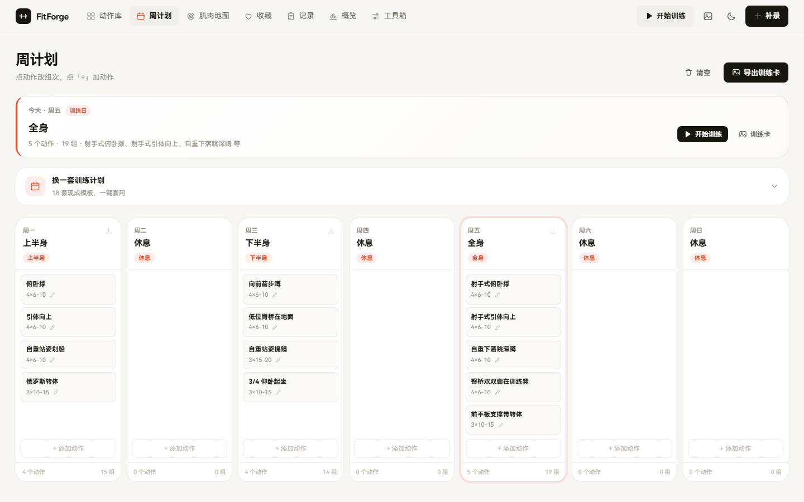
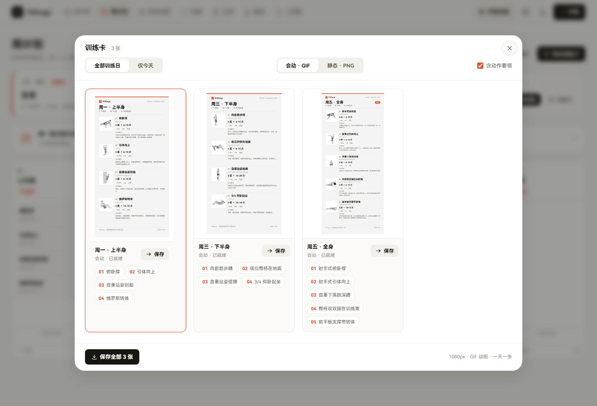
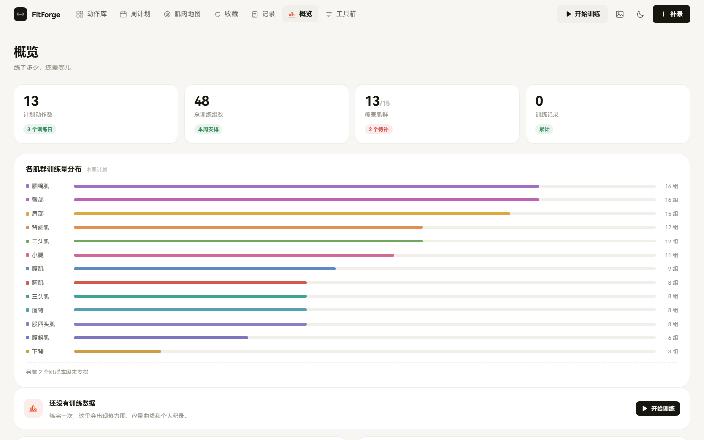
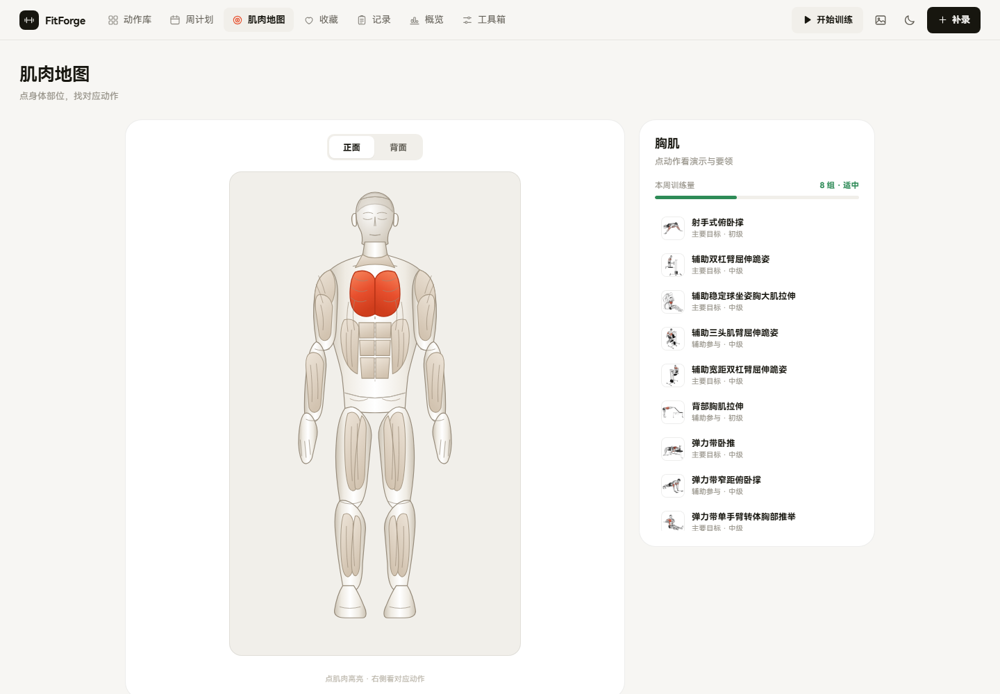

# FitForge · 健身动作库 & 周计划

> 本地离线的健身动作查询 / 周计划 / 引导式跟练工具。1324 个真人演示 GIF、18 套经典计划模板、会动的训练卡导出，**双击即用，全程不联网**。


## 特性

- **1324 个健身动作** — 中文动作名与分步要领，目标肌 / 协同肌 / 器械 / 力型 / 力学齐全，支持中文别名搜索（搜「推胸」「伏地挺身」都能命中）
- **真人 GIF 演示** — 素材本地打包，动作详情、跟练界面、导出的训练卡全部会动
- **周计划** — 18 套经典模板（StrongLifts 5×5、5/3/1、PHUL、Arnold、五分化、居家无器械、HIIT、核心、拉伸、办公室…），分类可筛，也可手动逐日编排
- **会动的训练卡** — 一天一张 GIF，左侧动作循环演示，可整周批量导出；周计划日卡右上角一键下载单日
- **引导式跟练** — 大 GIF 循环 + 分步要领 + 逐组打卡 + 休息倒计时 + PR 检测 + 下次加重量建议，中途退出可续练
- **肌肉地图** — 人体 32 个肌群分区点选，看动作列表与本周训练量
- **工具箱** — 1RM 估算、杠铃片配重、BMI / TDEE、心率区间、训练容量、本地 JSON 备份
- **概览统计** — 26 周训练热力图、周容量柱图、PR 榜、肌群覆盖提示
- **手机 / 电脑双端适配** — 手机底部导航，桌面顶栏；导出面板与跟练界面窄屏可用

## 快速开始

```bash
git clone https://github.com/soberbw-hash/FitForge.git
cd FitForge
```

用浏览器直接打开 `fitforge.html` 即可（双击文件也行）。

**注意**：`gifs/` 文件夹必须和 `fitforge.html` 放在同一目录，否则动作演示图加载不出来（应用会自动退回内嵌首帧图，不会白屏）。

## 截图

| 动作库 | 周计划 |
|---|---|
|  |  |

| 导出训练卡 | 训练概览 |
|---|---|
|  |  |

| 肌肉地图（灰白解剖线描，点肌群橙红高亮） |
|---|
|  |

> 人体图采用与动作 GIF 一致的灰白写实解剖线描风格，正面 / 背面共覆盖 15 个可点肌群；点右侧列表也会同步高亮，选到只存在于背面的肌群会自动翻面。

## 快捷键

| 按键 | 作用 |
|---|---|
| `1` ~ `7` | 切换页面 |
| `S` | 开始训练 |
| `/` | 聚焦搜索 |
| `?` | 打开帮助 |
| `Esc` | 关闭弹窗（后开先关） |

## 项目结构

```
FitForge/
├── fitforge.html        # 单文件成品（构建产物，双击即用）
├── gifs/                # 1324 个动作演示 GIF
├── index.html           # 源码页面骨架
├── style.css            # 样式（纸感浅色 / 暗色双主题）
├── app.js               # 核心应用逻辑
├── session.js           # 引导式跟练
├── power.js             # 工具箱 / 统计 / 交互增强
├── export_card.js       # 训练卡导出（GIF / PNG）
├── gif_encoder.js       # 纯前端 GIF89a 编码器（LZW + 局部帧更新）
├── data.js              # 动作数据 / 计划模板（构建产物）
├── extra_data.js        # 肌肉 / 标签 / 别名增强数据（构建产物）
├── thumbs_data.js       # GIF 首帧缩略图 dataURL（构建产物）
├── anim_frames.json     # GIF 抽帧动画数据（构建产物）
├── templates.js         # 18 套计划模板定义
├── translate.js         # 动作名规则式中文翻译引擎
├── body_svg.js          # Gym Visual 风格解剖人体肌群图（正/背面，15 个可点分区）
├── build_*.js           # 数据 / 增强 / 缩略图 / 打包构建脚本
├── build_anim.py        # GIF 抽帧脚本（需 Pillow）
└── docs/                # 调研报告与截图
```

## 从源码构建

环境要求：Node.js 18+、Python 3 + Pillow（仅 `build_anim.py` 需要）。

```bash
# 1. 生成动作数据（含中文名、肌群映射）
node build_data.js

# 2. 生成增强字段（目标肌中文、别名、标签）
node build_extra.js

# 3. GIF 抽帧 → anim_frames.json（已提供，可跳过）
python build_anim.py

# 4. 打包单文件（内联 CSS/JS/数据，输出 fitforge.html）
node build_html.js
```

## 数据来源与致谢

- 动作数据与 GIF 素材来自 [hasaneyldrm/exercises-dataset](https://github.com/hasaneyldrm/exercises-dataset)（23.5K⭐）
- GIF 图像版权归 [Gym Visual](https://gymvisual.com/) 所有，**商用前请自行核实授权**
- 功能设计参考了 free-exercise-db、wger、workout.cool、openGym、Strong / Hevy 等项目的交互思路

## 免责声明

本工具仅供健身学习参考，不构成医疗或专业训练建议。训练计划与重量建议请结合自身情况调整，有伤病或健康问题请咨询专业医生或教练。

## License

代码基于 [MIT License](LICENSE) 开源。`gifs/` 目录内的动作演示素材为第三方版权内容，不受 MIT 约束。
